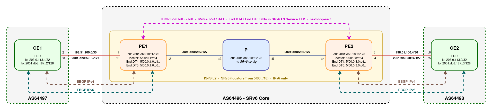

# SRv6 JunOS IPv4

Containerlab sim to test an IPv6-only core running SRv6, with edge CE routers connected with IPv4 networks.

IPv4 prefixes are announced in IBGP with End.DT4 SID to allow for SRv6 transport across the core and termination into the global IPv4 table on the egress PE.

## Lab

The lab expects two docker images to be present on the system, users may need to adjust the "image" names or use "docker tag" to ensure they are found on their system.

|Image Name|Decription|
|----------|----------|
|debian:clab|Vanilla debian container image with FRR installed (apt install frr)|
|vrnetlab/juniper_vjunos-router:25.4R1-S2.3|Juniper vjunos-router image|

vjunos-router is available free of charge to download from Juniper:

https://support.juniper.net/support/downloads/?p=vjunos-router

## Topology

[](diagram/srv6_junos_ipv4.pdf?raw=true)

## Config

The full configs are in [startup_configs](startup_configs)

Each PE gets an SRv6 locator from 5f00::/16, for instance PE2 is given 5f00:0:3::/64. 

```
set routing-options source-packet-routing srv6 locator LOC1 5f00:0:3::/64
```

This locator network advertised in IS-IS:
```
set protocols isis source-packet-routing srv6 locator LOC1
```

We allocate a end-dt4-sid to handle traffic for the global IPv4 table:
```
set protocols bgp source-packet-routing srv6 locator LOC1 end-dt4-sid 5f00:0:3:0:d4::
```
And then configure BGP to announce IPv4 unicast BGP routes with this SID:
```
set protocols bgp group IBGP family inet unicast extended-nexthop
set protocols bgp group IBGP family inet unicast advertise-srv6-service
set protocols bgp group IBGP family inet unicast accept-srv6-service
```

The 'P' router needs no segment routing config at all, it's just a plain IPv6 router running ISIS.

## Results

PE2 learns this route from CE2 over EBGP:
```
admin@pe2> show route receive-protocol bgp 198.51.100.6 table inet.0 

inet.0: 4 destinations, 4 routes (4 active, 0 holddown, 0 hidden)
  Prefix		  Nexthop	       MED     Lclpref    AS path
* 203.0.113.2/32          198.51.100.6         0                  64498 ?
```

PE1 gets this route in IBGP from PE2, destination is the End.DT4 SID we configured, 5f00:0:3:0:d4::
```
admin@pe1> show route 203.0.113.2/32 table inet.0 

inet.0: 4 destinations, 4 routes (4 active, 0 holddown, 0 hidden)
+ = Active Route, - = Last Active, * = Both

203.0.113.2/32     *[BGP/170] 00:26:51, MED 0, localpref 100, from 2001:db8:10::3
                      AS path: 64498 ?, validation-state: unverified
                    >  to fe80::aac1:abff:fefd:6857 via ge-0/0/1.0, SRv6 SID: 5f00:0:3:0:d4::, SRV6-Tunnel, Dest: 5f00:0:3::
```

On PE2 we can see the SID points to the global IPv4 table:
```
admin@pe2> show route protocol srv6 5f00:0:3:0:d4:: exact          

inet6.0: 20 destinations, 21 routes (20 active, 0 holddown, 0 hidden)
+ = Active Route, - = Last Active, * = Both

5f00:0:3:0:d4::/128*[SRV6/171] 00:36:50
                       to table inet.0
```

We can ping from CE1 to CE2 just fine:
```
root@ce1:~# ping -I 203.0.113.1 203.0.113.2 
PING 203.0.113.2 (203.0.113.2) from 203.0.113.1 : 56(84) bytes of data.
64 bytes from 203.0.113.2: icmp_seq=1 ttl=62 time=3.10 ms
64 bytes from 203.0.113.2: icmp_seq=2 ttl=62 time=3.17 ms
```
```
root@ce1:~# mtr --address 203.0.113.1 -w -c 3 203.0.113.2
Start: 2026-11-22T21:57:03+0000
HOST: ce1          Loss%   Snt   Last   Avg  Best  Wrst StDev
  1.|-- 198.51.100.1  0.0%     3    0.9   1.0   0.7   1.4   0.3
  2.|-- 198.51.100.5  0.0%     3    5.1   6.5   5.1   7.4   1.2
  3.|-- 203.0.113.2   0.0%     3    2.7   2.8   2.4   3.2   0.4
```

On the wire between PE1 and P the encap is as expected:
```
Frame 1: 138 bytes on wire (1104 bits), 138 bytes captured (1104 bits)
Ethernet II, Src: aa:c1:ab:53:04:f6 (aa:c1:ab:53:04:f6), Dst: aa:c1:ab:e0:ab:2e (aa:c1:ab:e0:ab:2e)
Internet Protocol Version 6, Src: 2001:db8:10::1, Dst: 5f00:0:3:0:d4::
Internet Protocol Version 4, Src: 203.0.113.1, Dst: 203.0.113.2
Internet Control Message Protocol
```
```
Frame 2: 138 bytes on wire (1104 bits), 138 bytes captured (1104 bits)
Ethernet II, Src: aa:c1:ab:e0:ab:2e (aa:c1:ab:e0:ab:2e), Dst: aa:c1:ab:53:04:f6 (aa:c1:ab:53:04:f6)
Internet Protocol Version 6, Src: 2001:db8:10::3, Dst: 5f00:0:1:0:d4::
Internet Protocol Version 4, Src: 203.0.113.2, Dst: 203.0.113.1
Internet Control Message Protocol
```

The P router just routes these like normal IPv6 packets, they are part of the /64 network picked as SRv6 locator on PE2:
```
admin@p> show route 5f00:0:3:0:d4:: 

inet6.0: 13 destinations, 13 routes (13 active, 0 holddown, 0 hidden)
+ = Active Route, - = Last Active, * = Both

5f00:0:3::/64      *[IS-IS/18] 00:27:13, metric 100
                    >  to fe80::aac1:abff:fe86:71eb via ge-0/0/1.0
```

We have no VRFs / routing instances defined anywhere:
```
admin@pe1> show route table ?
Possible completions:
  <table>              Name of routing table
  inet.0               
  inet6.0              
  inet6.3              
  iso.0                
  mgmt_junos.inet.0    
  mgmt_junos.inet6.0   
```
